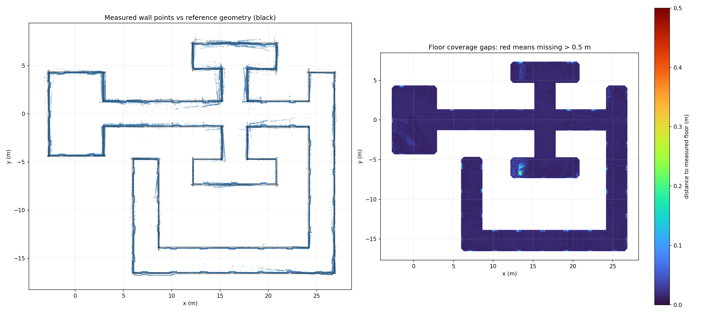
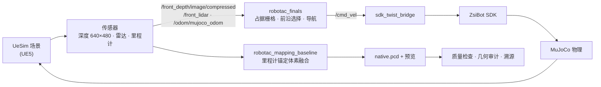

# ROBOTAC 自主建图（仿真）

[](LICENSE)


ROBOTAC 赛事“全自主建图”任务的仿真实现。机器狗在 **UeSim（UE5）+ MuJoCo** 仿真场景中全自主探索、避障、建图，结束时输出**原生 PCD 点云**，并附带预览图、质量报告、SHA256 与源码/标定指纹。

目标不是“跑起来就算完成”：程序要求传感器真实有数据、坐标系不跳变、关键组件不退出、磁盘充足，并在采集后做几何质量检查；任一条不满足都不会报 `COMPLETED`。

> 仓库包含算法源码、部署脚本、测试与验证记录。厂商仿真运行程序（约 7.5 GB）**未入库**，运行前需按 [`runtime/README.md`](runtime/README.md) 放回。所有结论均来自本机仿真，不代表实机验收。



## 特性

- **一条命令跑完全流程**：启动仿真 → 传感器校验 → 自主探索建图 → 稳定停车补扫 → 保存 → 质量核验。
- **全自主策略**：启动环视 → 安全前沿探索 → 采墙 → 基于实时点云的墙面/地面/顶部补扫，补扫要求新视角，避免原地重复。
- **里程计锚定体素融合（C++）**：2.5 cm 体素、深度地面采样、近地面归一化、扫描面滤波、时序置信度与多帧支持。
- **真实性保护**：传感器中断、坐标系跳变、位姿跳变、组件退出、磁盘不足时拒绝报成功；故障与主动停止都保留部分地图与 checkpoint。
- **可复现与可审计**：每轮结果记录 PCD、预览、日志、质量报告、SHA256、程序/标定版本指纹；质量判定为 fail-closed。
- **有明确边界**：`COMPLETED` 只表示通过设定的几何检查，不是官方评分，也不证明任意环境绝对零漂移。

## 系统架构



- **导航与探索**：激光构建实时射线占据栅格；前沿选择按信息量、可达性与安全性打分；控制器做局部避障与卡住检测。
- **建图**：以 MuJoCo 里程计为锚，逐帧把雷达点写入体素；深度融合深度地面采样，并对近地面做归一化。
- **质量**：保存后用离线几何审计按固定容差检查地面覆盖率、最大缺口、墙面覆盖率/残差/离群点、顶部条带等 11 项，全部通过才判定 `PASS_PROXY_CHECKS`。

## 目录结构

```text
.
├── docker.sh                     # 容器管理 + 一键 start/stop/status/repair/build
├── build.sh                      # 容器内 colcon 构建两个 ROS 2 包
├── run_auto_max.sh               # 容器内启动一次自主建图会话
├── install_dependencies.sh       # Ubuntu 22.04 / ROS Humble 依赖
├── config/config.json            # 仿真传感器配置（深度相机等）
├── deps/zsibot_sdk/              # 厂商 SDK（x86_64 动态库 + Python 绑定）
├── deployment/
│   ├── control.py                # start / stop / status / recover 生命周期
│   ├── simulation.py             # 托管 UeSim、MuJoCo、控制器三个进程
│   ├── check.py                  # 启动前有界就绪检查
│   ├── run_session.py            # 单轮任务监督：保存、校验、状态落盘
│   ├── audit_run.py              # 已保存地图的离线几何审计（fail-closed）
│   ├── provenance.py             # 源码/配置/厂商程序指纹
│   ├── telemetry.py              # 传感器新鲜度、非空与标定检查
│   ├── observer.py / gpu_probe.py / common.py
│   ├── tests/                    # 15 组 pytest 合约测试 + 录制的夹具
│   ├── validation/               # 时序、覆盖率、表面组成等离线验证工具与报告
│   └── SHA256SUMS.runtime.txt    # 厂商程序校验清单
├── dev_ws/
│   ├── src/robotac_mapping_baseline/   # C++ 建图包（体素融合 / GICP）
│   ├── tools/                          # PCD 预览、质量报告、深度桥接
│   └── midterm/                        # 自主建图 launch 与运行脚本
├── finals_ws/
│   ├── src/robotac_finals/             # 探索、导航、任务管理、可视化
│   └── test/                           # 点云产物校验脚本
├── runtime/                      # 厂商运行配置 + 许可证（src/ 未入库）
└── docs/                         # 使用说明、迁移说明、验证记录与历史清单
```

## 快速开始

**环境要求**

- 宿主机 Ubuntu 24.04，NVIDIA GPU 与可用的 Docker GPU 运行时；
- 本地镜像 `robotac-humble:local`（Ubuntu 22.04 + ROS 2 Humble + Python 3.10 + PCL/OpenCV/SciPy）；
- 厂商仿真运行文件已放回 `runtime/src/`（见 [`runtime/README.md`](runtime/README.md)），并可用 `deployment/SHA256SUMS.runtime.txt` 校验。

```bash
git clone https://github.com/MCYX12/robotac-auto-max.git
cd robotac-auto-max

# 1. 构建两个 ROS 2 包（容器内）
bash docker.sh build

# 2. 启动：仿真 + 传感器校验 + 自主建图 + 保存 + 质量核验
ROBOTAC_HEADLESS=0 MIDTERM_RVIZ=1 bash docker.sh start

# 3. 查看状态 / 中途停止（另开终端）
bash docker.sh status
bash docker.sh stop
```

结果默认写入 `dev_ws/midterm/runs/<运行编号>/`，包含 `_native.pcd`、`_preview.png`、`地图质量检查.md`、`result.json`、`SHA256SUMS.txt` 等。

**常用命令**

| 命令 | 作用 |
| --- | --- |
| `bash docker.sh start [编号]` | 启动仿真并跑完整自主建图任务 |
| `bash docker.sh run [编号]` | 仿真已运行时，只跑一轮建图 |
| `bash docker.sh sim` | 只启动仿真 |
| `bash docker.sh check` | 只做传感器/环境就绪检查 |
| `bash docker.sh audit <编号>` | 对已保存地图做离线几何审计 |
| `bash docker.sh status` | 查看仿真与最近任务状态 |
| `bash docker.sh stop` | 请求停止并保留部分结果 |
| `bash docker.sh repair` | GPU 异常时重建项目容器（保留源码与结果） |
| `bash docker.sh build` | 重新编译两个 ROS 2 包 |
| `bash docker.sh shell` | 进入容器 |

## 结果判定

| 状态 | 含义 |
| --- | --- |
| `COMPLETED` | 采集完成，且全部设定的质量检查通过 |
| `NEEDS_REVIEW` | 已保存，但几何质量未达标 |
| `FAILED` | 故障（传感器中断、位姿跳变、组件退出、磁盘不足等） |
| `CANCELLED` | 操作者主动停止，已尽力保存部分地图 |

几何审计检查项（`deployment/audit_run.py`，全部为布尔且 fail-closed）：

- 地面覆盖率 @10 cm ≥ 99.5%，@20 cm ≥ 99.999%，最大地面缺口半径 ≤ 25 cm；
- 墙面覆盖率 @15 cm ≥ 99.5%，中位残差 ≤ 5 mm，>20 cm 离群点 ≤ 0.01%；
- 每面墙 @20 cm 覆盖率 ≥ 99.5%，单墙最大缺口 ≤ 25 cm；
- 顶部条带 @20 cm 覆盖率 ≥ 99.5%，最大缺口 ≤ 25 cm；
- 全高度足迹 >35 cm 离群点 ≤ 0.01%，所有点位于设定高度范围内。

覆盖率按明确距离容差计算；几何检查与局部时序结果不能证明全场绝对零漂移，也不等于实机验收。

## 测试

```bash
# 在容器内执行（需要 ROS 2 / numpy / scipy）
bash docker.sh shell
cd /workspace && python3 -m pytest deployment/tests -q
```

`deployment/tests/` 覆盖故障合约、运行期硬化、时序置信度、地面/墙面补扫、溯源与产物校验等；`deployment/validation/` 存放可复跑的离线验证工具与 2026-11 的历史报告。

## 未入库内容

以下内容体积过大或属于本机运行产物，**不进入 git**，但原工作目录中仍保留：

| 路径 | 体积 | 说明 |
| --- | --- | --- |
| `runtime/src/` | 约 7.5 GB | 厂商 UeSim / MuJoCo / 控制器运行文件，见 [`runtime/README.md`](runtime/README.md) |
| `deployment/validation/*_raw_*/` | 约 23 GB | 早期采集的原始点云与录像 |
| `history/` | 约 147 MB | 迁移/修复前的源码备份 |
| `dev_ws/midterm/runs/` | 约 100 MB/轮 | 每轮建图结果 |
| `deployment/logs/` | 约 9 MB/轮 | 每轮运行日志 |
| `*/build_humble/`、`*/install_humble/`、`*/log/` | 构建产物 | 由 `bash docker.sh build` 重新生成 |

## 文档

- [`docs/DOCKER_USAGE.md`](docs/DOCKER_USAGE.md)：日常操作（启动、看结果、中途停止、故障处理）。
- [`docs/MIGRATION_NOTES.md`](docs/MIGRATION_NOTES.md)：迁移与部署说明、环境与构建约束。
- [`docs/VALIDATION_2026-11-02.md`](docs/VALIDATION_2026-11-02.md)：2026-11-02 的本机部署实测记录。
- [`docs/provenance/`](docs/provenance/)：最初迁移清单与整理前的源码 SHA256 快照。

## 已知限制

- 建图是**里程计锚定的体素融合**，不是带回环优化的完整 SLAM；长距离场景仍可能出现漂移。
- 简化场景几何只在采集完成后离线核验，不参与导航、不生成或填充点云。
- 14 分钟专项历史未通过全部检查；修复后未重新验证 14 分钟，默认预算保持 30 分钟、速度上限 0.45 m/s。
- 仅在容器内仿真验证，未在实物机器人上验收。

## 许可

[BSD-3-Clause](LICENSE)，Copyright (c) 2025, ZsiBot。
厂商 SDK 与运行文件同样遵循其自带许可，见 `deps/zsibot_sdk/LICENSE`、`runtime/LICENSE`。
