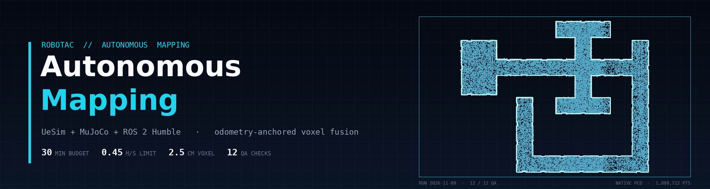
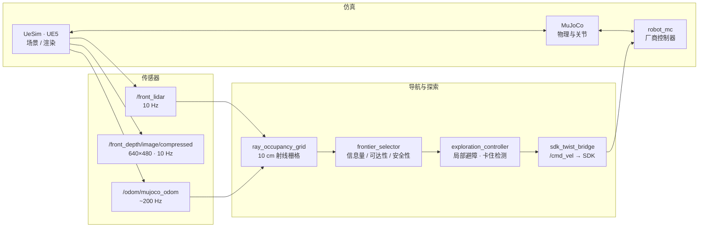
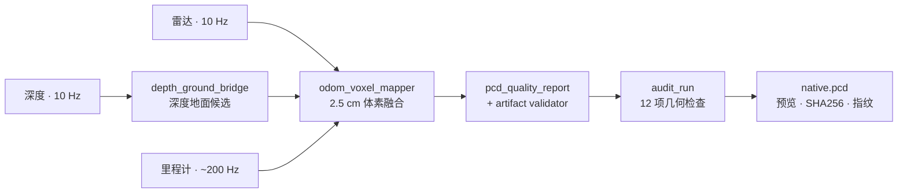
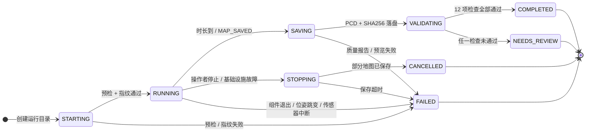
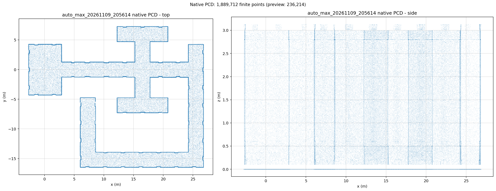
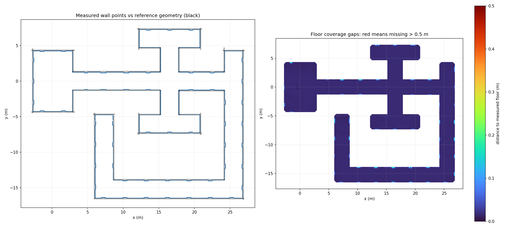

<p align="center">
  
  <br>
  <sub>头图：本轮原生 PCD 的俯视点云（1,889,712 点中抽稀 12 万点绘制），随仓库附生成脚本与采样数据</sub>
</p>

<p align="center">
  <a href="LICENSE"></a>
  
  
  
  
  
</p>

<p align="center">
  <strong>机器狗全自主建图 · 仿真闭环 · 可审计交付</strong><br>
  <sub>UeSim (UE5) + MuJoCo + ROS 2 Humble · 里程计锚定体素融合 · 原生 PCD + 12 项几何门禁</sub>
</p>

---

ROBOTAC 赛事“全自主建图”任务的完整仿真实现。机器狗在 UE5 场景中自主探索、避障、建图，结束时输出**赛事提交格式的原生 PCD**，并附预览图、质量报告、SHA256 与源码/标定指纹。

设计目标不是“跑起来就算完成”：传感器必须真实有数据、坐标系不得跳变、关键组件不得退出、磁盘必须充足，采集后还要通过 12 项固定容差的几何检查——任一条不满足都不会报 `COMPLETED`。

| 采集预算 | 速度上限 | 体素分辨率 | 导航栅格 | 质量门禁 |
| :---: | :---: | :---: | :---: | :---: |
| **30 min** | **0.45 m/s** | **2.5 cm** | **10 cm** | **12 项** |

> [!IMPORTANT]
> 仓库不包含约 7.5 GB 的厂商仿真运行文件（UeSim / MuJoCo / 控制器）。克隆后需按 [`runtime/README.md`](runtime/README.md) 放回 `runtime/src/`，并用 `deployment/SHA256SUMS.runtime.txt` 校验；哈希不符时程序会直接拒绝启动。

<p align="center">
  <a href="#核心能力">核心能力</a> ·
  <a href="#系统架构">系统架构</a> ·
  <a href="#任务状态机">状态机</a> ·
  <a href="#质量门禁">质量门禁</a> ·
  <a href="#快速开始">快速开始</a> ·
  <a href="#仓库结构">仓库结构</a> ·
  <a href="#实测记录">实测</a> ·
  <a href="#已知限制">限制</a>
</p>

## 核心能力

| 能力 | 实现 | 关键约束 |
| --- | --- | --- |
| **全自主探索** | 启动环视 → 安全前沿探索 → 采墙 → 基于实时点云的墙面/地面/顶部补扫 | 补扫必须提供新视角（≥ 20° 或 ≥ 0.75 m），不重复采样 |
| **鲁棒建图** | 里程计锚定体素融合 + 深度融合地面采样 + 扫描面滤波 + 时序置信度 | 2.5 cm 体素；快速转向帧与近地面点单独处理 |
| **真实性保护** | 传感器新鲜度、位姿跳变、组件存活、磁盘余量四类看门狗 | 任一异常都不允许报成功，只保存部分地图与 checkpoint |
| **可审计交付** | 每轮记录 SHA256、源码/标定/厂商程序指纹、质量报告与终态原因 | 判定 fail-closed；运行期文件被改动即判失败 |

## 系统架构

**运行时闭环**：仿真提供传感器数据，导航栈据此决策，速度指令经 SDK 回到仿真。



**建图与交付**：点云先写体素融合，再经基础校验、几何审计，最后连同指纹一起落盘。



### ROS 2 接口

| 话题 | 类型 | 频率 / 规格 | 用途 |
| --- | --- | --- | --- |
| `/front_lidar` | `sensor_msgs/PointCloud2` | 10 Hz | 建图输入、导航射线栅格 |
| `/front_depth/image/compressed` | `sensor_msgs/CompressedImage` | 10 Hz · 640×480 | 深度融合地面采样 |
| `/odom/mujoco_odom` | `nav_msgs/Odometry` | ~200 Hz | 位姿锚定与一致性检查 |
| `/robotac/nav_map` | `nav_msgs/OccupancyGrid` | 10 cm 栅格 | 导航占据地图（不参与评分点云） |
| `/robotac/finals/score_cloud` | `sensor_msgs/PointCloud2` | 抽稀 | 评分点云（建图输出，RViz 调试） |
| `/cmd_vel` | `geometry_msgs/Twist` | — | 速度指令，经 SDK 下发 |
| `/robotac/depth_ground_candidates` | `sensor_msgs/PointCloud2` | — | 深度地面候选点 |
| `/robotac/filtered_lidar` | `sensor_msgs/PointCloud2` | — | 扫描面滤波后的雷达点 |
| `/robotac/finals/preview_cloud` | `sensor_msgs/PointCloud2` | 抽稀 | RViz 结构预览 |

导航栅格与预览点云是**独立通路**：它们不影响 `score_cloud` 与最终提交的 PCD。

## 任务状态机



| 终态 | 含义 | 退出码 |
| --- | --- | :---: |
| `COMPLETED` | 采集完成且 12 项几何检查全部通过 | 0 |
| `NEEDS_REVIEW` | 地图已保存，但几何质量未达标 | 5 |
| `FAILED` | 预检失败、组件退出、传感器中断、落盘或审计失败 | 2 / 4 |
| `CANCELLED` | 操作者主动停止，已尽力保存部分地图 | 130 |

## 质量门禁

保存后由 `deployment/audit_run.py` 离线审计，全部为布尔判定且 **fail-closed**；报告同时写入 `result.json` 与 `地图质量检查.md`。

| # | 检查项 | 阈值 |
| :-: | --- | --- |
| 1 | 地面覆盖率 @10 cm | ≥ 99.5% |
| 2 | 地面覆盖率 @20 cm | ≥ 99.999% |
| 3 | 最大地面缺口半径 | ≤ 25 cm |
| 4 | 墙面覆盖率 @15 cm | ≥ 99.5% |
| 5 | 墙面中位残差（对参考几何） | ≤ 5 mm |
| 6 | 墙面离群点（>20 cm） | ≤ 0.01% |
| 7 | 全高度足迹离群点（>35 cm） | ≤ 0.01% |
| 8 | 全部点位于设定高度范围 | 必须为真 |
| 9 | 单面墙覆盖率 @20 cm | ≥ 99.5% |
| 10 | 单面墙最大缺口 | ≤ 25 cm |
| 11 | 顶部条带覆盖率 @20 cm | ≥ 99.5% |
| 12 | 顶部条带最大缺口 | ≤ 25 cm |

> [!NOTE]
> 覆盖率按明确的距离容差计算，是几何代理指标，不是赛事官方评分。它能证明“在给定容差下没有明显缺口”，不能证明任意环境绝对零漂移。

## 快速开始

**前置条件**

| 项目 | 要求 |
| --- | --- |
| 宿主机 | Ubuntu 24.04，NVIDIA GPU（Vulkan 可用） |
| 容器 | Docker + NVIDIA Container Toolkit |
| 镜像 | `robotac-humble:local`（Ubuntu 22.04 / ROS 2 Humble / Python 3.10 / PCL / OpenCV / SciPy） |
| 厂商运行文件 | 放回 `runtime/src/`（约 7.5 GB），见 [`runtime/README.md`](runtime/README.md) |
| 磁盘 | 启动前至少 2 GB 可用；保存前至少 512 MB |

```bash
git clone https://github.com/MCYX12/robotac-auto-max.git
cd robotac-auto-max

# 1. 校验厂商运行文件
sha256sum -c deployment/SHA256SUMS.runtime.txt

# 2. 构建两个 ROS 2 包（容器内，2.5 cm 体素建图为 C++ Release）
bash docker.sh build

# 3. 一键跑完：仿真 → 预检 → 自主探索建图 → 保存 → 质量审计
ROBOTAC_HEADLESS=0 MIDTERM_RVIZ=1 bash docker.sh start

# 4. 状态与停止（另开终端）
bash docker.sh status
bash docker.sh stop
```

**运行产物**

```text
dev_ws/midterm/runs/<run_id>/
├── <run_id>_native.pcd              # 原生点云（提交物）
├── <run_id>_native.pcd.checkpoint.pcd   # 中途检查点
├── <run_id>_native.pcd.ground_voxels.csv    # 地面体素证据
├── <run_id>_native.pcd.rejected_voxels.csv  # 被拒体素证据
├── <run_id>_preview.png             # 俯视 / 侧视预览
├── <run_id>_quality.json            # 点云代理指标
├── <run_id>_motion.json             # 任务状态、计时、保存结果
├── <run_id>_native.pcd.acquisition.json  # 建图内核计数与滤波统计
├── 地图质量检查.md                   # 可读版质量报告
├── geometry_audit.json              # 12 项检查明细与缺口坐标
├── geometry_audit.png               # 墙面比对 + 地面缺口热力图
├── result.json                      # 终态、原因、耗时、点数
├── provenance.json / provenance_check.json   # 指纹与一致性
├── SHA256SUMS.txt                   # PCD 校验和
└── autonomous.log                   # 全量运行日志
```

**常用命令**

| 命令 | 作用 |
| --- | --- |
| `bash docker.sh start [编号]` | 启动仿真并跑完整任务 |
| `bash docker.sh run [编号]` | 仿真已运行时只跑一轮建图 |
| `bash docker.sh sim` | 只启动仿真 |
| `bash docker.sh check` | 只做传感器 / 环境就绪检查 |
| `bash docker.sh audit <编号>` | 对已保存地图重新做几何审计 |
| `bash docker.sh status` | 仿真与最近任务状态 |
| `bash docker.sh stop` | 请求停止并保留部分结果 |
| `bash docker.sh repair` | GPU 异常时重建容器（保留源码与结果） |
| `bash docker.sh build` | 重新编译 ROS 2 包 |
| `bash docker.sh shell` | 进入容器 |

## 仓库结构

```text
.
├── docker.sh                       # 容器生命周期 + 一键 start/stop/status/repair
├── build.sh                        # 容器内 colcon 构建
├── run_auto_max.sh                 # 容器内启动单轮建图
├── install_dependencies.sh         # Ubuntu 22.04 / ROS Humble 依赖
├── config/config.json              # 仿真传感器配置
├── deps/zsibot_sdk/                # 厂商 SDK（x86_64 动态库 + Python 绑定）
├── deployment/
│   ├── control.py                  # start / stop / status / recover
│   ├── simulation.py               # 托管 UeSim、MuJoCo、控制器
│   ├── check.py                    # 有界就绪检查
│   ├── run_session.py              # 单轮任务监督、保存、终态判定
│   ├── audit_run.py                # 离线几何审计（12 项，fail-closed）
│   ├── provenance.py               # 源码 / 配置 / 厂商程序指纹
│   ├── telemetry.py                # 传感器新鲜度、非空、标定
│   ├── observer.py · gpu_probe.py · common.py
│   ├── tests/                      # pytest 合约测试 + 录制夹具
│   ├── validation/                 # 时序 / 覆盖率 / 表面组成等离线工具与报告
│   └── SHA256SUMS.runtime.txt      # 厂商程序校验清单
├── dev_ws/
│   ├── src/robotac_mapping_baseline/   # C++ 建图包（体素融合 / GICP / 滤波）
│   ├── tools/                          # PCD 预览、质量报告、深度桥接
│   └── midterm/                        # 自主建图 launch 与运行脚本
├── finals_ws/
│   ├── src/robotac_finals/             # 探索、导航、任务管理、可视化
│   └── test/                           # 点云产物校验
├── runtime/                        # 厂商配置 + 许可证（src/ 未入库）
└── docs/                           # 使用说明、迁移说明、验证记录、历史校验清单
```

## 测试

```bash
bash docker.sh build          # 注入类测试会直接拉起 odom_voxel_mapper
bash docker.sh shell
cd /workspace && ROS_DOMAIN_ID=178 python3 -m pytest deployment/tests -q
```

注入类测试强制 `ROS_DOMAIN_ID=178`，与正在运行的仿真（24）隔离；覆盖故障合约、运行期硬化、时序置信度、地面/墙面补扫、溯源与产物校验。

## 实测记录

### 2026-11-09 · 30 分钟完整运行

| 项目 | 结果 |
| --- | --- |
| 运行编号 | `auto_max_20261109_205614` |
| 终态 | `COMPLETED` · 12 / 12 门禁通过 |
| 任务耗时 | 1802.0 s（预算 1800 s，`hard_deadline` 触发，记录完成 1806.6 s） |
| 原生 PCD | 1,889,712 点 · 22,676,720 字节 |
| 场景包围盒 | 29.76 × 24.08 × 3.14 m |
| 地面覆盖 | 99.65% @10 cm · 100% @20 cm |
| 墙面覆盖 | 99.76% @15 cm，最差单墙 100% @20 cm |
| 最大缺口 | 地面 0.173 m · 墙面 0.171 m · 顶部条带 0.133 m |
| 离群点 | 墙面 0.00000% · 全高度 0 点 |
| PCD SHA256 | `9dcee16fe147…f8b9f` |

<p align="center">
  
  <br>
  <sub>原生 PCD 预览：俯视 29.8 × 24.1 m 场景（左）与侧视高度分布（右）；共 1,889,712 点</sub>
</p>

<p align="center">
  
  <br>
  <sub>几何审计：测量墙面点云（蓝）与简化参考几何（黑）对比（左）；地面覆盖缺口热力图（右）</sub>
</p>

完整报告与采集统计见 [`docs/evidence/auto_max_20261109_205614/`](docs/evidence/auto_max_20261109_205614/README.md)。

<details>
<summary><b>2026-11-02 · 首轮部署验证（840 s）</b></summary>

| 指标 | 结果 |
| --- | --- |
| 两包源码编译 | 通过（ROS 2 Humble，C++ Release） |
| 12 s 数据完整性 | 雷达 120 帧 / 里程计 2401 条 / 深度 120 帧 |
| SDK 链路 | 连接、站立、进入 ACTIVE |
| 采集预算 / 记录完成 | 840 s / 842.007 s |
| 终态 | `COMPLETED`（`native_pcd_saved_and_validated`） |
| 原生 PCD | 1,985,482 个有限点 / 23,825,960 字节 |
| 无效点比例 | 0，artifact validator PASS，SHA256 通过 |

详见 [`docs/VALIDATION_2026-11-02.md`](docs/VALIDATION_2026-11-02.md)。

</details>

## 未入库内容

| 路径 | 体积 | 原因 |
| --- | --- | --- |
| `runtime/src/` | ~7.5 GB | 厂商仿真运行文件，超出仓库限制 |
| `deployment/validation/*_raw_*/` | ~23 GB | 早期原始采集数据 |
| `history/` | ~147 MB | 迁移 / 修复前源码备份 |
| `dev_ws/midterm/runs/` | ~105 MB / 轮 | 每轮完整结果（报告与预览已归档至 `docs/evidence/`） |
| `deployment/logs/` | ~9 MB / 轮 | 每轮运行日志 |
| `*/build_humble/`、`*/install_humble/`、`*/log/` | — | 编译产物，可重新生成 |

这些内容仍保留在原始工作目录；仓库只保留源码、脚本、测试、验证报告与体积较小的证据图（不含 22 MB 的 PCD 本体）。

## 适用边界

- **验证范围**：本机仿真（UeSim + MuJoCo）30 分钟全流程；实机部署需重新标定深度与相机参数并单独验收。
- **建图模型**：里程计锚定的体素融合，不含回环优化；长距离场景仍可能出现漂移，这也是质量门禁按固定容差而非“零误差”判定的原因。
- **评分关系**：12 项是几何代理检查（覆盖率 / 缺口 / 离群点 / 残差），不是赛事官方评分；场景几何只在采集后离线核验，不参与导航或点云填充。
- **时间预算**：30 分钟、0.45 m/s 为本机验证配置；历史 14 分钟专项未达标，默认预算因此上调，参数可按场地与设备收紧。

## 文档

| 文档 | 内容 |
| --- | --- |
| [`docs/DOCKER_USAGE.md`](docs/DOCKER_USAGE.md) | 日常操作：启动、看结果、中途停止、故障处理 |
| [`docs/MIGRATION_NOTES.md`](docs/MIGRATION_NOTES.md) | 迁移与部署说明、环境与构建约束 |
| [`docs/VALIDATION_2026-11-02.md`](docs/VALIDATION_2026-11-02.md) | 本机部署实测记录 |
| [`docs/evidence/`](docs/evidence/) | 30 分钟完整运行的报告、审计图与预览 |
| [`runtime/README.md`](runtime/README.md) | 厂商运行文件的放置与校验 |
| [`docs/provenance/`](docs/provenance/) | 最初迁移清单与整理前 SHA256 快照 |

## 许可

[BSD-3-Clause](LICENSE)，Copyright (c) 2025, ZsiBot。厂商 SDK 与运行文件遵循其自带许可（`deps/zsibot_sdk/LICENSE`、`runtime/LICENSE`）。

<p align="center">
  <sub>Built for the ROBOTAC finals · 结果只代表仿真环境</sub>
</p>
